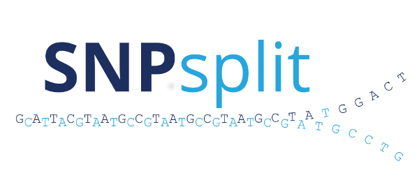

 

## Allele-specific alignment sorting

> **See the documentation: https://felixkrueger.github.io/SNPsplit**

**Update December 2022:**

SNPsplit has now been updated to work with new release of the [Mouse Genomes Project](https://www.mousegenomes.org/). This means that it will now assume the GRCm39 mouse genome build by default, and use the latest SNP annotation file (v8: [mgp_REL2021_snps.vcf.gz](https://ftp.ebi.ac.uk/pub/databases/mousegenomes/REL-2112-v8-SNPs_Indels/mgp_REL2021_snps.vcf.gz)).

## Installation

SNPsplit 1.0 is a Rust rewrite: one binary that needs nothing else installed. Download `snpsplit-<version>-<platform>.tar.gz` from the [Releases page](https://github.com/FelixKrueger/SNPsplit/releases) (Linux x86_64 and aarch64, macOS Apple Silicon) and put the unpacked folder on your `PATH`, use the image `ghcr.io/felixkrueger/snpsplit`, or `cargo install snpsplit`. See [the Rust docs](https://felixkrueger.github.io/SNPsplit/rust/) for details.

The Perl version (0.9.x) is in maintenance freeze. To use it, download the [0.9.2 release](https://github.com/FelixKrueger/SNPsplit/releases/tag/0.9.2) and extract the files into an installation folder; it needs [Samtools](http://samtools.sourceforge.net/) on the `PATH`.

In the repository, the Perl scripts are in `legacy_perl/` and the Rust is in `rust/`.

## Documentation
The SNPsplit documentation can be found here: [SNPsplit User Guide](https://felixkrueger.github.io/SNPsplit)

## Links
- SNPsplit publication at F1000 Research:
  * https://f1000research.com/articles/5-1479/v2
  
- Here is a link to the [SNPsplit project site](https://www.bioinformatics.babraham.ac.uk/projects/SNPsplit/) at the Babraham Institute

## Credits

SNPsplit was written by Felix Krueger at [Babraham Bioinformatics](https://www.bioinformatics.babraham.ac.uk), now part of Altos Bioinformatics.

 

